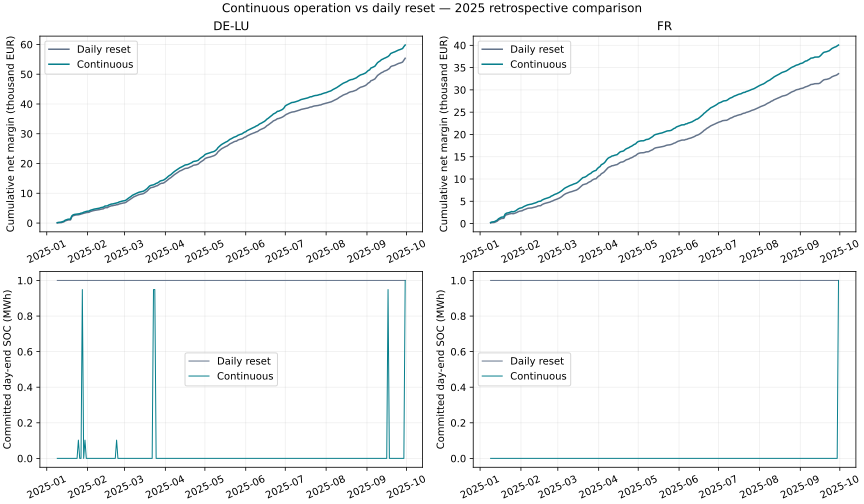

# Continuous battery operation — retrospective 2025 comparison

## What changed and why

The previous benchmark restored SOC to 50% each day. This version carries committed energy across midnight, plans two local delivery days, commits only the first, and revises the provisional second day at the next decision. The forecast remains the same seven-day mean, fixed at the issuance cutoff for both planning days. This isolates a structural modelling change without training a new forecasting model.

At D-1 09:00, the battery's opening SOC for D is projected through the remaining fixed D-1 schedule. Physical execution is assumed exact. No future actual price enters planning. Accepted day-ahead quantities and later actual-price cashflows are recorded in a separate trade ledger; intraday and reserves are not implemented.

## Frozen assumptions

- 9 January–30 September 2025 in DE-LU and France; 265 days / 6,359 hours per zone. Already inspected data: retrospective, not an unseen test.
- 1 MW / 2 MWh; 90% round-trip efficiency; EUR10/MWh discharged cycling cost.
- Planning terminal SOC 50% in the main scenario; 0% and 100% sensitivity cases. These apply at the provisional horizon end, not every committed midnight.
- Actual initial and final evaluation SOC are 1 MWh in every case. The last horizon is shortened and the common final SOC overrides the sensitivity target.
- Fee sensitivity is EUR1/MWh on each buy/sell leg, an illustrative cost, with a fee-matched daily-reset comparison.
- Full-period perfect foresight is solved to optimality separately at each fee. It has the same physical and initial/final conditions and is an upper bound, not a forecast strategy.

## Results

| Market | Policy | Net margin EUR | Transaction costs EUR | Loss days | Bound gap EUR | Midnights away from 50% |
|---|---|---:|---:|---:|---:|---:|
| DE-LU | global_oracle_fee_0 | 66,394.25 | 0.00 | 0 | 0.00 | 264 |
| DE-LU | daily_reset_fee_0 | 55,361.95 | 0.00 | 1 | 11,032.30 | 0 |
| DE-LU | global_oracle_fee_1 | 64,664.78 | 1,712.82 | 0 | 0.00 | 264 |
| DE-LU | daily_reset_fee_1 | 53,435.65 | 1,814.47 | 2 | 11,229.13 | 0 |
| DE-LU | continuous | 59,810.90 | 0.00 | 0 | 6,583.35 | 264 |
| DE-LU | fee_1 | 58,055.91 | 1,686.02 | 2 | 6,608.87 | 264 |
| DE-LU | terminal_0 | 59,810.90 | 0.00 | 0 | 6,583.35 | 264 |
| DE-LU | terminal_1 | 59,810.90 | 0.00 | 0 | 6,583.35 | 264 |
| FR | global_oracle_fee_0 | 47,503.54 | 0.00 | 0 | 0.00 | 264 |
| FR | daily_reset_fee_0 | 33,633.12 | 0.00 | 2 | 13,870.43 | 0 |
| FR | global_oracle_fee_1 | 45,649.73 | 1,825.66 | 1 | 0.00 | 264 |
| FR | daily_reset_fee_1 | 31,610.04 | 1,900.55 | 6 | 14,039.69 | 0 |
| FR | continuous | 40,068.58 | 0.00 | 1 | 7,434.96 | 264 |
| FR | fee_1 | 38,054.12 | 1,881.37 | 4 | 7,595.61 | 264 |
| FR | terminal_0 | 40,068.58 | 0.00 | 1 | 7,434.96 | 264 |
| FR | terminal_1 | 40,068.58 | 0.00 | 1 | 7,434.96 | 264 |

Policy names: continuous = main 50% planning target, zero fee; fee_1 = same target with EUR1/MWh each side; terminal_0/terminal_1 = zero-fee planning terminal sensitivities. Global oracle is non-causal perfect foresight. No winning policy is selected from these retrospective results.

## Main comparisons

**DE-LU:** continuous operation changes margin by EUR+4,448.94 against daily reset at zero fee. With the illustrative fee, the difference against the fee-matched reset is EUR+4,620.26. The main strategy ends 264 of the 264 internal days away from 50% SOC.

**FR:** continuous operation changes margin by EUR+6,435.47 against daily reset at zero fee. With the illustrative fee, the difference against the fee-matched reset is EUR+6,444.08. The main strategy ends 264 of the 264 internal days away from 50% SOC.

Loss-day counts are calendar accounting windows. With energy carried across days, purchases today may support sales tomorrow; daily profits are not independent cycles. Equal final inventory makes the full-period comparison more meaningful. Carrying SOC can help or hurt under imperfect forecasts and finite-horizon terminal targets.

## Largest daily main-policy differences

These post-run examples illustrate accounting and boundary changes, not an additional strategy-selection rule.

| Market | Date | Main minus reset EUR | Main start SOC MWh | Main end SOC MWh |
|---|---|---:|---:|---:|
| DE-LU | 2025-09-30 | -104.23 | 0.000 | 1.000 |
| DE-LU | 2025-07-01 | +333.21 | 0.000 | 0.000 |
| FR | 2025-05-31 | -54.15 | 0.000 | 0.000 |
| FR | 2025-01-09 | +99.75 | 1.000 | 0.000 |

## Validation and limits

The zero-fee daily comparator reproduces all published seven-day daily results. Runtime checks enforce physical bounds, no simultaneous charging/discharging, SOC continuity, cutoff-history availability, unchanged prior commitments, ledger cashflow and full-period oracle dominance. Dedicated tests exercise two-day leakage protection, cutoff projection, analytical fees/settlement, DST and negative prices.

The forecast repeats one issuance-time hourly profile across both days, so extra horizon is not extra predictive information. Terminal assumptions can materially influence actions. This remains a price-taking backtest with perfect acceptance and execution, no imbalance exposure, no outages and no bid/ask order book. Fees are sensitivity assumptions. Results are simulated operating margin, not investment profit.

## Reproduce and inspect

- [Frozen protocol](../docs/continuous-operation-protocol.md) and [configuration](../config/continuous-operation.json).
- [Audit](continuous_audit_2025.json), [metrics](continuous_metrics_2025.csv), [daily](continuous_daily_2025.csv), [monthly](continuous_monthly_2025.csv), [decision and projected-state audit](continuous_decisions_2025.csv), [selected hourly cases](continuous_case_dispatch_2025.csv).
- [Compressed full dispatch and trade ledger](../data/continuous/README.md). Run python scripts/analyse_continuous.py with recovered price inputs and the recorded dependencies.
- Source: Bundesnetzagentur | SMARD.de via Energy-Charts, CC BY 4.0, as documented in the input recovery audit.
- Next: verify intraday data and execution assumptions before adding incremental trades against the preserved day-ahead positions.
