# Hourly ML diagnosis — reconstructed and reconciled schedules

Full dispatch has been regenerated from byte-verified public inputs and frozen model settings. Daily financial results reconcile with the earlier published backtest. Original hourly hashes were not retained; hourly tie-breaking may differ even when daily results match. These are reconstructed schedules, not a recovered original binary file.

## Full-period RF minus seven-day accounting

Sales and purchases retain negative-price signs. Net difference = sales difference − purchase-expenditure difference − cycling-cost difference.

| Market | Sales difference EUR | Purchase expenditure difference EUR | Cycling cost difference EUR | Net difference EUR |
|---|---:|---:|---:|---:|
| DE-LU | -4236.85 | -1445.91 | -144.33 | -2646.62 |
| FR | -25929.41 | -19434.93 | -2174.80 | -4319.68 |

These are exact accounting contributions; price and quantity changes are mixed in each component. A negative purchase-expenditure difference helps margin. A negative sales difference hurts margin. They do not independently establish a causal forecasting failure.

## Selected daily decisions

Both adverse and favourable cases are retained. The largest adverse/beneficial hourly cashflows below are booked contributions, not isolated profitable trades: battery SOC links charging and discharge across hours.

### DE-LU — 2025-01-20 (underperformance 1)

RF net EUR639.79; baseline EUR1028.88; gap EUR-389.09. Sales contribution EUR-776.21; purchase contribution EUR+368.15; cycling contribution EUR+18.97.

| Strategy | Forecast range EUR/MWh | Charged MWh | Discharged MWh | Weighted purchase price | Weighted sale price |
|---|---:|---:|---:|---:|---:|
| Seven-day | 105.60 to 197.49 | 4.216 | 3.795 | 150.61 | 448.48 |
| RF | 100.00 to 185.26 | 2.108 | 1.897 | 126.59 | 487.86 |

Largest adverse hourly RF-minus-baseline contribution: EUR-421.99 at 08:00 CET, actual price EUR431.99/MWh. Baseline/RF charge: 0.000/0.000 MW; discharge: 1.000/0.000 MW; opening SOC: 2.000/2.000 MWh.

Largest favourable hourly RF-minus-baseline contribution: EUR+392.12 at 16:00 CET, actual price EUR402.12/MWh. Baseline/RF charge: 0.000/0.000 MW; discharge: -0.000/1.000 MW; opening SOC: 2.000/2.000 MWh.

Seven-day: 10 missed spike classifications; discharged 3.795 MWh in those hours.
RF: 10 missed spike classifications; discharged 1.897 MWh in those hours.

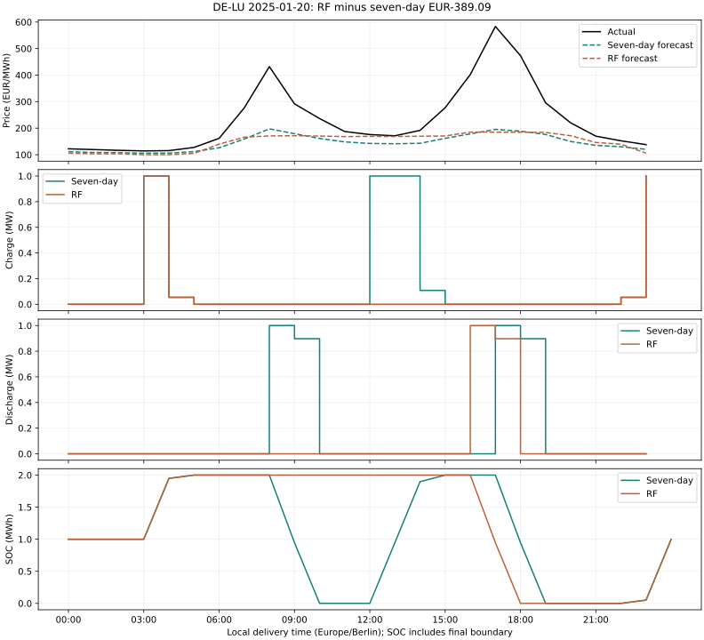

### DE-LU — 2025-01-21 (underperformance 2)

RF net EUR167.64; baseline EUR368.26; gap EUR-200.61. Sales contribution EUR-533.92; purchase contribution EUR+313.84; cycling contribution EUR+19.46.

| Strategy | Forecast range EUR/MWh | Charged MWh | Discharged MWh | Weighted purchase price | Weighted sale price |
|---|---:|---:|---:|---:|---:|
| Seven-day | 110.89 to 198.77 | 4.216 | 3.795 | 132.65 | 254.43 |
| RF | 106.00 to 141.71 | 2.054 | 1.849 | 119.49 | 233.45 |

Largest adverse hourly RF-minus-baseline contribution: EUR-291.15 at 17:00 CET, actual price EUR301.15/MWh. Baseline/RF charge: 0.000/0.000 MW; discharge: 1.000/0.000 MW; opening SOC: 2.000/1.105 MWh.

Largest favourable hourly RF-minus-baseline contribution: EUR+147.44 at 12:00 CET, actual price EUR147.44/MWh. Baseline/RF charge: 1.000/0.000 MW; discharge: 0.000/0.000 MW; opening SOC: 0.000/1.105 MWh.

Seven-day: 6 missed spike classifications; discharged 3.795 MWh in those hours.
RF: 6 missed spike classifications; discharged 1.849 MWh in those hours.

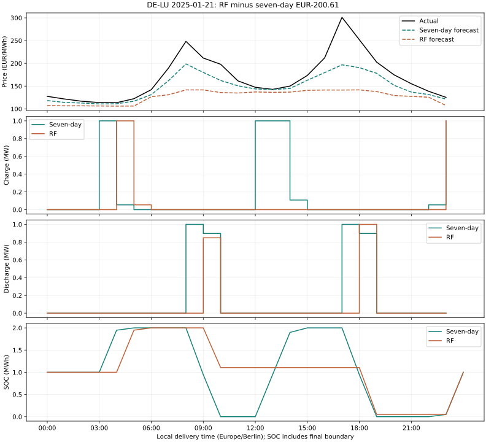

### DE-LU — 2025-04-27 (underperformance 3)

RF net EUR213.80; baseline EUR407.65; gap EUR-193.85. Sales contribution EUR-60.17; purchase contribution EUR-143.16; cycling contribution EUR+9.49.

| Strategy | Forecast range EUR/MWh | Charged MWh | Discharged MWh | Weighted purchase price | Weighted sale price |
|---|---:|---:|---:|---:|---:|
| Seven-day | 32.63 to 154.87 | 4.162 | 3.746 | -24.28 | 91.84 |
| RF | 5.90 to 125.09 | 3.108 | 2.797 | 13.55 | 101.48 |

Largest adverse hourly RF-minus-baseline contribution: EUR-129.81 at 13:00 CEST, actual price EUR-129.81/MWh. Baseline/RF charge: 1.000/0.000 MW; discharge: 0.000/0.000 MW; opening SOC: 0.103/0.949 MWh.

Largest favourable hourly RF-minus-baseline contribution: EUR+59.12 at 03:00 CEST, actual price EUR59.12/MWh. Baseline/RF charge: 1.000/0.000 MW; discharge: 0.000/0.000 MW; opening SOC: 1.051/1.000 MWh.

Seven-day: 0 missed spike classifications; discharged 0.000 MWh in those hours.
RF: 0 missed spike classifications; discharged 0.000 MWh in those hours.

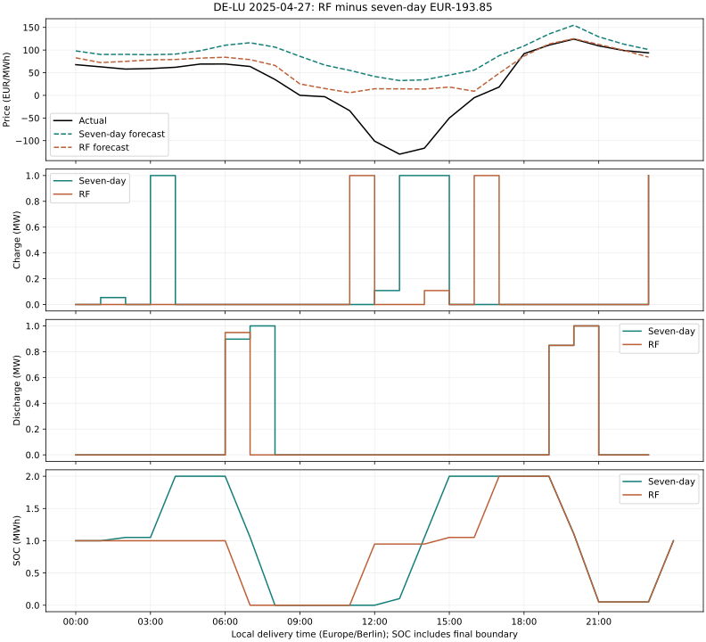

### DE-LU — 2025-05-11 (underperformance 4)

RF net EUR439.58; baseline EUR627.67; gap EUR-188.09. Sales contribution EUR+14.16; purchase contribution EUR-201.74; cycling contribution EUR-0.51.

| Strategy | Forecast range EUR/MWh | Charged MWh | Discharged MWh | Weighted purchase price | Weighted sale price |
|---|---:|---:|---:|---:|---:|
| Seven-day | 30.06 to 138.54 | 4.162 | 3.746 | -72.78 | 96.69 |
| RF | -47.38 to 120.98 | 4.219 | 3.797 | -23.98 | 99.11 |

Largest adverse hourly RF-minus-baseline contribution: EUR-223.24 at 13:00 CEST, actual price EUR-250.32/MWh. Baseline/RF charge: 1.000/0.108 MW; discharge: 0.000/0.000 MW; opening SOC: 0.949/1.897 MWh.

Largest favourable hourly RF-minus-baseline contribution: EUR+84.82 at 03:00 CEST, actual price EUR95.42/MWh. Baseline/RF charge: 1.000/0.111 MW; discharge: 0.000/0.000 MW; opening SOC: 1.051/0.000 MWh.

Seven-day: 0 missed spike classifications; discharged 0.000 MWh in those hours.
RF: 0 missed spike classifications; discharged 0.000 MWh in those hours.

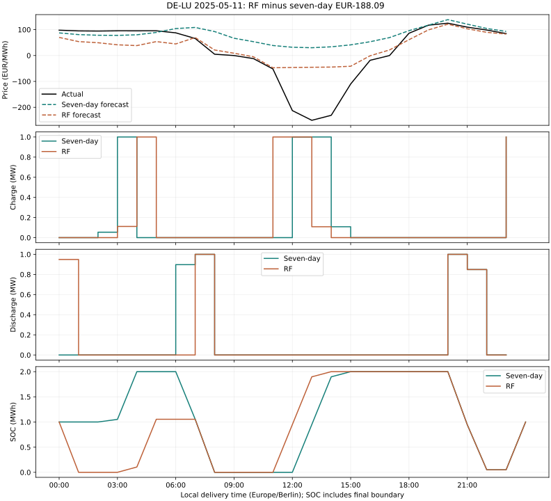

### DE-LU — 2025-02-14 (underperformance 5)

RF net EUR132.00; baseline EUR317.25; gap EUR-185.25. Sales contribution EUR-676.25; purchase contribution EUR+462.54; cycling contribution EUR+28.46.

| Strategy | Forecast range EUR/MWh | Charged MWh | Discharged MWh | Weighted purchase price | Weighted sale price |
|---|---:|---:|---:|---:|---:|
| Seven-day | 106.31 to 164.20 | 4.216 | 3.795 | 142.08 | 251.47 |
| RF | 105.60 to 129.17 | 1.054 | 0.949 | 129.52 | 293.06 |

Largest adverse hourly RF-minus-baseline contribution: EUR-255.64 at 08:00 CET, actual price EUR265.64/MWh. Baseline/RF charge: 0.000/0.000 MW; discharge: 1.000/0.000 MW; opening SOC: 2.000/2.000 MWh.

Largest favourable hourly RF-minus-baseline contribution: EUR+149.86 at 12:00 CET, actual price EUR149.86/MWh. Baseline/RF charge: 1.000/0.000 MW; discharge: 0.000/0.000 MW; opening SOC: 0.103/2.000 MWh.

Seven-day: 6 missed spike classifications; discharged 3.795 MWh in those hours.
RF: 6 missed spike classifications; discharged 0.949 MWh in those hours.

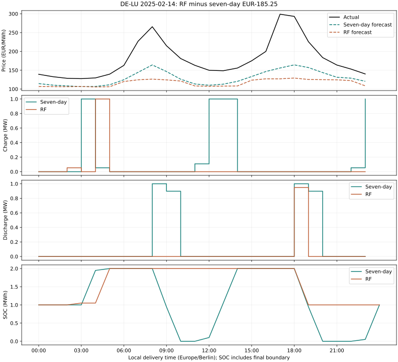

### DE-LU — 2025-06-30 (outperformance 1)

RF net EUR405.84; baseline EUR279.77; gap EUR+126.07. Sales contribution EUR+358.87; purchase contribution EUR-213.83; cycling contribution EUR-18.97.

| Strategy | Forecast range EUR/MWh | Charged MWh | Discharged MWh | Weighted purchase price | Weighted sale price |
|---|---:|---:|---:|---:|---:|
| Seven-day | -11.09 to 136.09 | 2.165 | 1.949 | 19.90 | 175.68 |
| RF | 42.26 to 177.54 | 4.273 | 3.846 | 60.12 | 182.32 |

Largest adverse hourly RF-minus-baseline contribution: EUR-115.66 at 23:00 CEST, actual price EUR122.65/MWh. Baseline/RF charge: 0.057/1.000 MW; discharge: 0.000/0.000 MW; opening SOC: 0.946/0.051 MWh.

Largest favourable hourly RF-minus-baseline contribution: EUR+250.34 at 20:00 CEST, actual price EUR288.97/MWh. Baseline/RF charge: 0.000/0.000 MW; discharge: 0.000/0.897 MW; opening SOC: 2.000/2.000 MWh.

Seven-day: 2 missed spike classifications; discharged 1.000 MWh in those hours.
RF: 2 missed spike classifications; discharged 1.897 MWh in those hours.

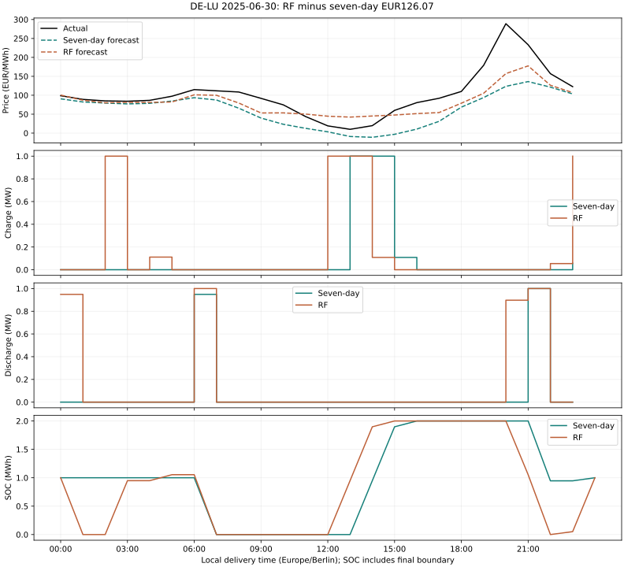

### DE-LU — 2025-08-05 (outperformance 2)

RF net EUR219.49; baseline EUR109.20; gap EUR+110.29. Sales contribution EUR+233.25; purchase contribution EUR-104.96; cycling contribution EUR-18.00.

| Strategy | Forecast range EUR/MWh | Charged MWh | Discharged MWh | Weighted purchase price | Weighted sale price |
|---|---:|---:|---:|---:|---:|
| Seven-day | 22.02 to 114.52 | 2.108 | 1.897 | -10.63 | 55.74 |
| RF | 41.54 to 117.57 | 4.108 | 3.697 | 20.10 | 91.69 |

Largest adverse hourly RF-minus-baseline contribution: EUR-81.00 at 23:00 CEST, actual price EUR81.00/MWh. Baseline/RF charge: 0.000/1.000 MW; discharge: 0.000/0.000 MW; opening SOC: 1.000/0.051 MWh.

Largest favourable hourly RF-minus-baseline contribution: EUR+97.15 at 21:00 CEST, actual price EUR107.15/MWh. Baseline/RF charge: 0.000/0.000 MW; discharge: 0.000/1.000 MW; opening SOC: 1.000/1.105 MWh.

Seven-day: 0 missed spike classifications; discharged 0.000 MWh in those hours.
RF: 0 missed spike classifications; discharged 0.000 MWh in those hours.

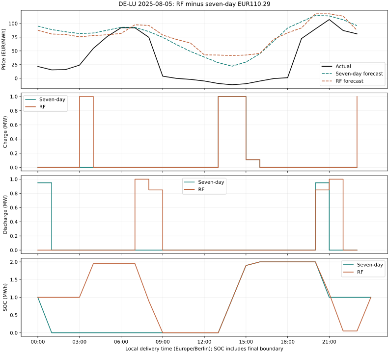

### DE-LU — 2025-06-01 (outperformance 3)

RF net EUR187.54; baseline EUR111.57; gap EUR+75.98. Sales contribution EUR-15.91; purchase contribution EUR+82.88; cycling contribution EUR+9.00.

| Strategy | Forecast range EUR/MWh | Charged MWh | Discharged MWh | Weighted purchase price | Weighted sale price |
|---|---:|---:|---:|---:|---:|
| Seven-day | 4.91 to 123.92 | 3.165 | 2.849 | 18.10 | 69.28 |
| RF | -14.79 to 118.82 | 2.165 | 1.949 | -11.82 | 93.11 |

Largest adverse hourly RF-minus-baseline contribution: EUR-82.20 at 21:00 CEST, actual price EUR106.86/MWh. Baseline/RF charge: 0.000/0.000 MW; discharge: 0.849/0.000 MW; opening SOC: 0.946/0.946 MWh.

Largest favourable hourly RF-minus-baseline contribution: EUR+85.33 at 23:00 CEST, actual price EUR90.49/MWh. Baseline/RF charge: 1.000/0.057 MW; discharge: 0.000/0.000 MW; opening SOC: 0.051/0.946 MWh.

Seven-day: 0 missed spike classifications; discharged 0.000 MWh in those hours.
RF: 0 missed spike classifications; discharged 0.000 MWh in those hours.

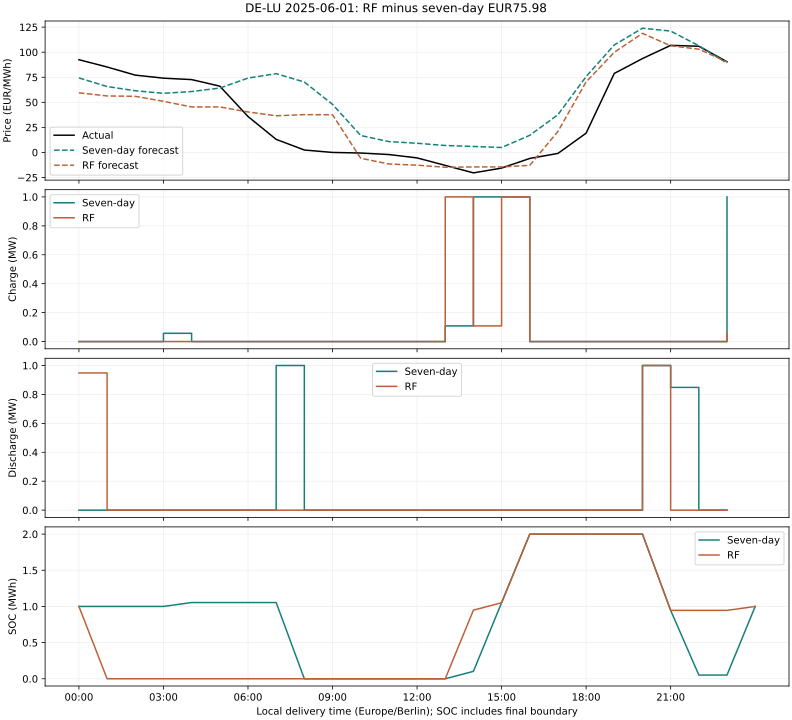

### FR — 2025-01-20 (underperformance 1)

RF net EUR0.00; baseline EUR604.92; gap EUR-604.92. Sales contribution EUR-1286.85; purchase contribution EUR+643.99; cycling contribution EUR+37.95.

| Strategy | Forecast range EUR/MWh | Charged MWh | Discharged MWh | Weighted purchase price | Weighted sale price |
|---|---:|---:|---:|---:|---:|
| Seven-day | 107.34 to 188.04 | 4.216 | 3.795 | 152.74 | 339.12 |
| RF | 98.49 to 106.20 | 0.000 | 0.000 | idle | idle |

Largest adverse hourly RF-minus-baseline contribution: EUR-463.28 at 18:00 CET, actual price EUR473.28/MWh. Baseline/RF charge: 0.000/0.000 MW; discharge: 1.000/0.000 MW; opening SOC: 2.000/1.000 MWh.

Largest favourable hourly RF-minus-baseline contribution: EUR+182.73 at 14:00 CET, actual price EUR182.73/MWh. Baseline/RF charge: 1.000/0.000 MW; discharge: 0.000/0.000 MW; opening SOC: 0.949/1.000 MWh.

RF chooses inactivity across this day under its forecast and the fixed costs/constraints. The baseline captures positive realised value. This supports a missed-opportunity diagnosis for this schedule; it does not establish why the forest learned this forecast shape.

Seven-day: 8 missed spike classifications; discharged 3.795 MWh in those hours.
RF: 8 missed spike classifications; discharged 0.000 MWh in those hours.

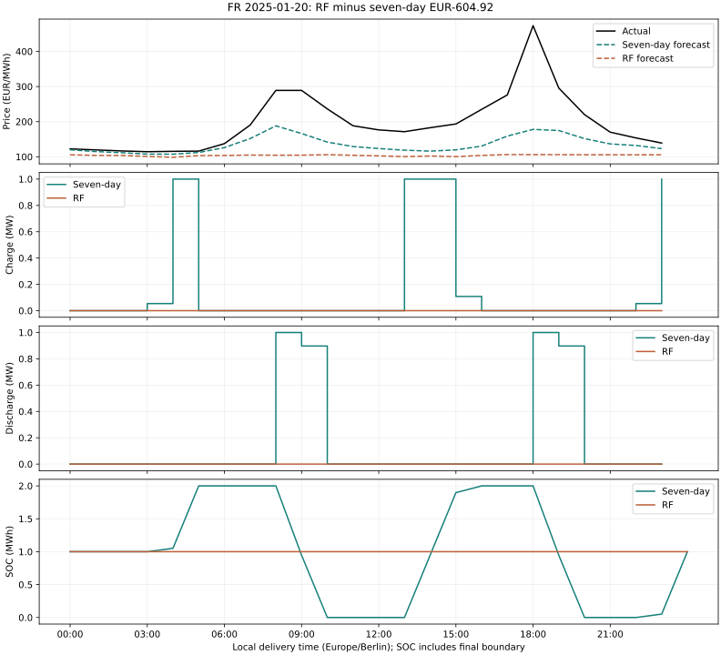

### FR — 2025-02-17 (underperformance 2)

RF net EUR0.00; baseline EUR236.99; gap EUR-236.99. Sales contribution EUR-753.79; purchase contribution EUR+479.83; cycling contribution EUR+36.97.

| Strategy | Forecast range EUR/MWh | Charged MWh | Discharged MWh | Weighted purchase price | Weighted sale price |
|---|---:|---:|---:|---:|---:|
| Seven-day | 113.57 to 184.90 | 4.108 | 3.697 | 116.80 | 203.87 |
| RF | 95.95 to 106.19 | 0.000 | 0.000 | idle | idle |

Largest adverse hourly RF-minus-baseline contribution: EUR-205.52 at 19:00 CET, actual price EUR215.52/MWh. Baseline/RF charge: 0.000/0.000 MW; discharge: 1.000/0.000 MW; opening SOC: 1.054/1.000 MWh.

Largest favourable hourly RF-minus-baseline contribution: EUR+130.60 at 23:00 CET, actual price EUR130.60/MWh. Baseline/RF charge: 1.000/0.000 MW; discharge: 0.000/0.000 MW; opening SOC: 0.051/1.000 MWh.

RF chooses inactivity across this day under its forecast and the fixed costs/constraints. The baseline captures positive realised value. This supports a missed-opportunity diagnosis for this schedule; it does not establish why the forest learned this forecast shape.

Seven-day: 4 missed spike classifications; discharged 2.897 MWh in those hours.
RF: 4 missed spike classifications; discharged 0.000 MWh in those hours.

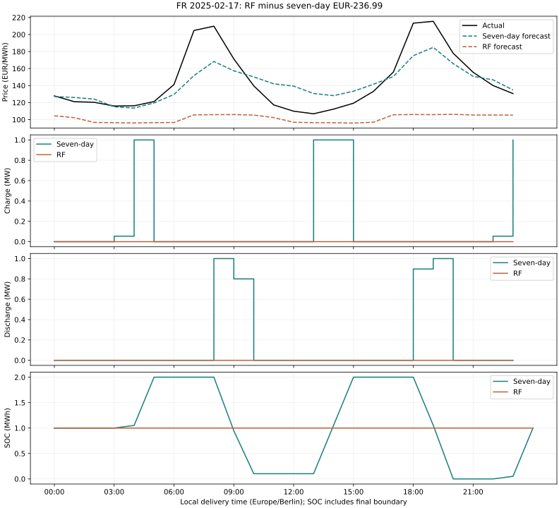

### FR — 2025-01-15 (underperformance 3)

RF net EUR48.05; baseline EUR277.95; gap EUR-229.90. Sales contribution EUR-833.59; purchase contribution EUR+566.71; cycling contribution EUR+36.97.

| Strategy | Forecast range EUR/MWh | Charged MWh | Discharged MWh | Weighted purchase price | Weighted sale price |
|---|---:|---:|---:|---:|---:|
| Seven-day | 59.83 to 139.15 | 5.162 | 4.646 | 133.93 | 218.63 |
| RF | 71.60 to 106.89 | 1.054 | 0.949 | 118.25 | 192.04 |

Largest adverse hourly RF-minus-baseline contribution: EUR-265.00 at 08:00 CET, actual price EUR275.00/MWh. Baseline/RF charge: 0.000/0.000 MW; discharge: 1.000/0.000 MW; opening SOC: 2.000/1.000 MWh.

Largest favourable hourly RF-minus-baseline contribution: EUR+172.70 at 07:00 CET, actual price EUR192.04/MWh. Baseline/RF charge: 0.000/0.000 MW; discharge: 0.000/0.949 MW; opening SOC: 2.000/2.000 MWh.

Seven-day: 4 missed spike classifications; discharged 3.795 MWh in those hours.
RF: 4 missed spike classifications; discharged 0.000 MWh in those hours.

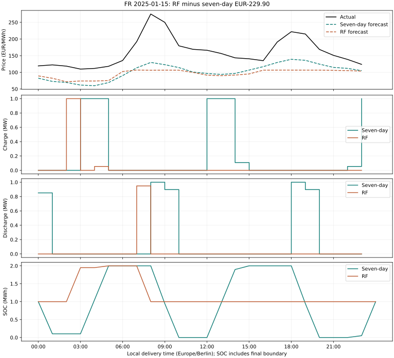

### FR — 2025-01-21 (underperformance 4)

RF net EUR0.00; baseline EUR204.85; gap EUR-204.85. Sales contribution EUR-812.33; purchase contribution EUR+569.53; cycling contribution EUR+37.95.

| Strategy | Forecast range EUR/MWh | Charged MWh | Discharged MWh | Weighted purchase price | Weighted sale price |
|---|---:|---:|---:|---:|---:|
| Seven-day | 112.37 to 189.27 | 4.216 | 3.795 | 135.08 | 214.07 |
| RF | 98.23 to 106.21 | 0.000 | 0.000 | idle | idle |

Largest adverse hourly RF-minus-baseline contribution: EUR-235.00 at 08:00 CET, actual price EUR245.00/MWh. Baseline/RF charge: 0.000/0.000 MW; discharge: 1.000/0.000 MW; opening SOC: 2.000/1.000 MWh.

Largest favourable hourly RF-minus-baseline contribution: EUR+151.03 at 14:00 CET, actual price EUR151.03/MWh. Baseline/RF charge: 1.000/0.000 MW; discharge: 0.000/0.000 MW; opening SOC: 0.949/1.000 MWh.

RF chooses inactivity across this day under its forecast and the fixed costs/constraints. The baseline captures positive realised value. This supports a missed-opportunity diagnosis for this schedule; it does not establish why the forest learned this forecast shape.

Seven-day: 3 missed spike classifications; discharged 2.897 MWh in those hours.
RF: 3 missed spike classifications; discharged 0.000 MWh in those hours.

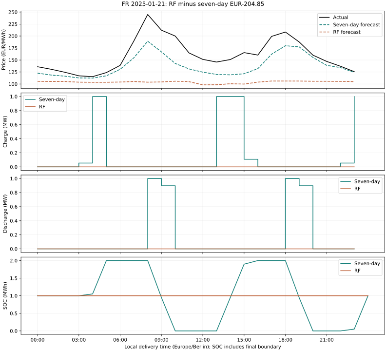

### FR — 2025-01-17 (underperformance 5)

RF net EUR-17.79; baseline EUR148.33; gap EUR-166.12. Sales contribution EUR-466.77; purchase contribution EUR+280.71; cycling contribution EUR+19.95.

| Strategy | Forecast range EUR/MWh | Charged MWh | Discharged MWh | Weighted purchase price | Weighted sale price |
|---|---:|---:|---:|---:|---:|
| Seven-day | 83.27 to 159.95 | 4.216 | 3.795 | 122.25 | 184.92 |
| RF | 86.40 to 108.49 | 2.000 | 1.800 | 117.38 | 130.53 |

Largest adverse hourly RF-minus-baseline contribution: EUR-198.13 at 08:00 CET, actual price EUR208.13/MWh. Baseline/RF charge: 0.000/0.000 MW; discharge: 1.000/0.000 MW; opening SOC: 2.000/1.000 MWh.

Largest favourable hourly RF-minus-baseline contribution: EUR+127.05 at 23:00 CET, actual price EUR127.05/MWh. Baseline/RF charge: 1.000/0.000 MW; discharge: 0.000/0.000 MW; opening SOC: 0.051/1.000 MWh.

Seven-day: 1 missed spike classifications; discharged 1.000 MWh in those hours.
RF: 1 missed spike classifications; discharged 0.000 MWh in those hours.

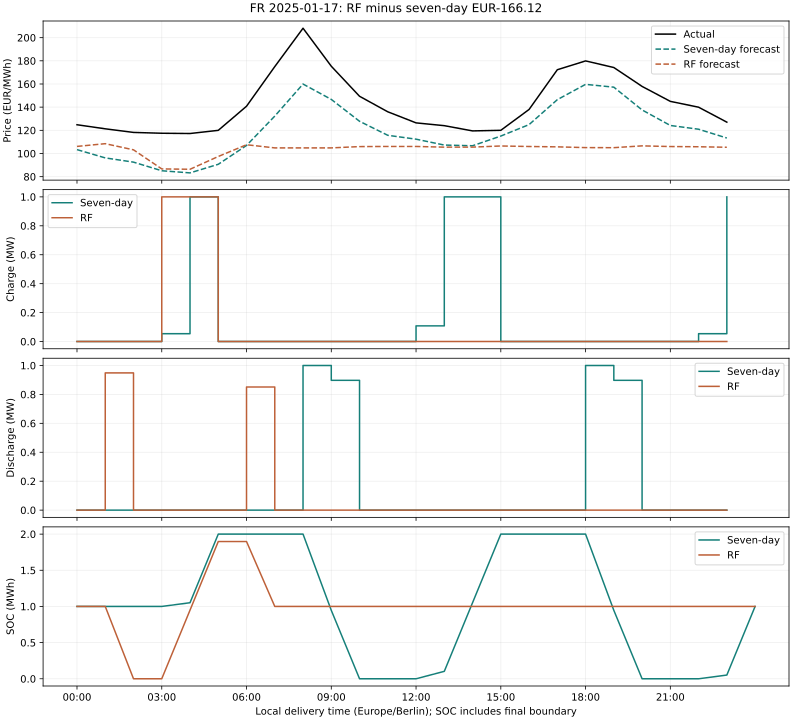

### FR — 2025-05-11 (outperformance 1)

RF net EUR247.01; baseline EUR139.35; gap EUR+107.66. Sales contribution EUR-41.36; purchase contribution EUR+122.02; cycling contribution EUR+27.00.

| Strategy | Forecast range EUR/MWh | Charged MWh | Discharged MWh | Weighted purchase price | Weighted sale price |
|---|---:|---:|---:|---:|---:|
| Seven-day | 0.03 to 47.51 | 5.108 | 4.597 | -20.05 | 18.03 |
| RF | -16.46 to 42.25 | 2.108 | 1.897 | -106.46 | 21.90 |

Largest adverse hourly RF-minus-baseline contribution: EUR-25.01 at 21:00 CEST, actual price EUR35.01/MWh. Baseline/RF charge: 0.000/0.000 MW; discharge: 1.000/0.000 MW; opening SOC: 2.000/2.000 MWh.

Largest favourable hourly RF-minus-baseline contribution: EUR+97.96 at 15:00 CEST, actual price EUR-109.84/MWh. Baseline/RF charge: 0.108/1.000 MW; discharge: 0.000/0.000 MW; opening SOC: 1.897/1.051 MWh.

Seven-day: 0 missed spike classifications; discharged 0.000 MWh in those hours.
RF: 0 missed spike classifications; discharged 0.000 MWh in those hours.

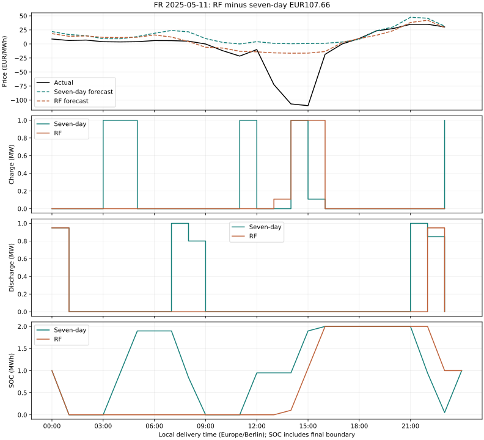

### FR — 2025-07-07 (outperformance 2)

RF net EUR88.08; baseline EUR5.84; gap EUR+82.24. Sales contribution EUR+30.28; purchase contribution EUR+51.44; cycling contribution EUR+0.51.

| Strategy | Forecast range EUR/MWh | Charged MWh | Discharged MWh | Weighted purchase price | Weighted sale price |
|---|---:|---:|---:|---:|---:|
| Seven-day | 29.88 to 135.69 | 3.165 | 2.849 | 31.72 | 47.29 |
| RF | 23.89 to 92.64 | 3.108 | 2.797 | 15.75 | 58.98 |

Largest adverse hourly RF-minus-baseline contribution: EUR-40.20 at 20:00 CEST, actual price EUR50.20/MWh. Baseline/RF charge: 0.000/0.000 MW; discharge: 1.000/0.000 MW; opening SOC: 2.000/2.000 MWh.

Largest favourable hourly RF-minus-baseline contribution: EUR+78.98 at 23:00 CEST, actual price EUR78.98/MWh. Baseline/RF charge: 1.000/0.000 MW; discharge: 0.000/0.000 MW; opening SOC: 0.051/1.000 MWh.

Seven-day: 0 missed spike classifications; discharged 0.000 MWh in those hours.
RF: 0 missed spike classifications; discharged 0.000 MWh in those hours.

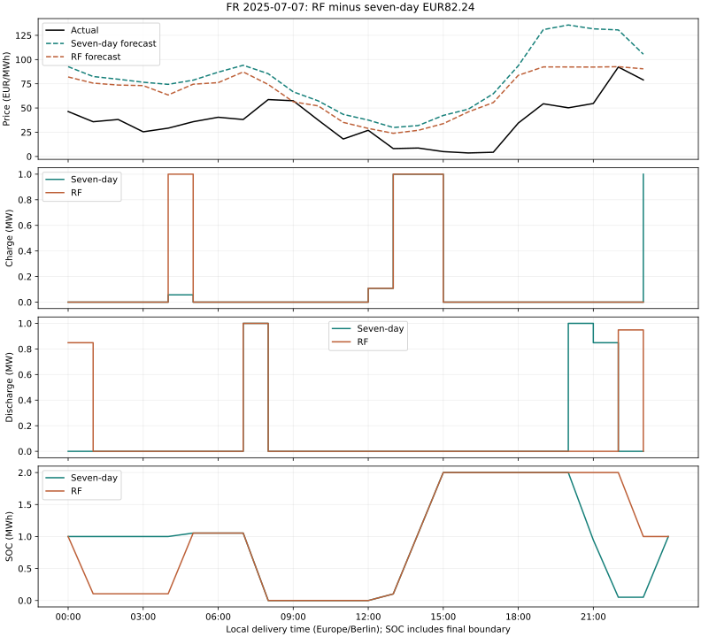

### FR — 2025-05-10 (outperformance 3)

RF net EUR254.36; baseline EUR181.13; gap EUR+73.24. Sales contribution EUR-17.70; purchase contribution EUR+80.43; cycling contribution EUR+10.51.

| Strategy | Forecast range EUR/MWh | Charged MWh | Discharged MWh | Weighted purchase price | Weighted sale price |
|---|---:|---:|---:|---:|---:|
| Seven-day | -0.15 to 51.34 | 3.276 | 2.949 | -39.74 | 27.27 |
| RF | -19.40 to 58.36 | 2.108 | 1.897 | -99.91 | 33.05 |

Largest adverse hourly RF-minus-baseline contribution: EUR-23.07 at 11:00 CEST, actual price EUR-23.07/MWh. Baseline/RF charge: 1.000/0.000 MW; discharge: 0.000/0.000 MW; opening SOC: -0.000/0.000 MWh.

Largest favourable hourly RF-minus-baseline contribution: EUR+83.93 at 13:00 CEST, actual price EUR-94.11/MWh. Baseline/RF charge: 0.108/1.000 MW; discharge: 0.000/0.000 MW; opening SOC: 0.949/-0.000 MWh.

Seven-day: 0 missed spike classifications; discharged 0.000 MWh in those hours.
RF: 0 missed spike classifications; discharged 0.000 MWh in those hours.

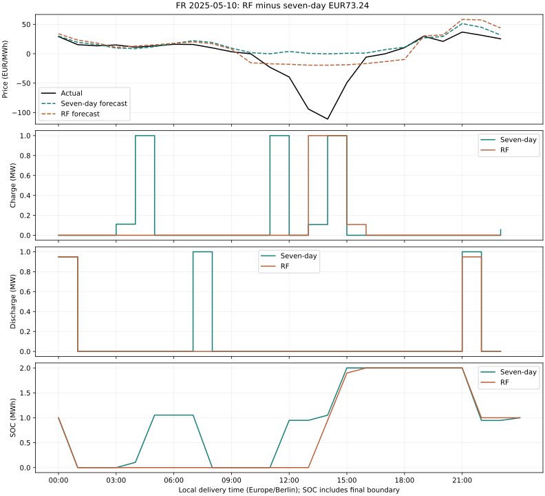

## Scope and reproducibility

- No model changes, retuning or new holdout claims. This diagnoses the inspected January–September 2025 period.
- Fixed daily 50% starting/ending SOC, 1 MW / 2 MWh, 90% round-trip efficiency and EUR10/MWh discharged cycling cost.
- Physical feasibility, hourly continuity, unchanged settlement accounting and published daily totals are checked before publication.
- [Recovery audit](dispatch_recovery_2025.json), [all daily accounting](ml_diagnosis_hourly_reconciled_daily_2025.csv), [selected hourly schedules](ml_diagnosis_selected_dispatch_2025.csv).
- [Full compressed hourly data and price inputs](../data/recovered/README.md).
- Reproduce with scripts/recover_dispatch_2025.py, scripts/diagnose_ml_2025.py and scripts/publish_ml_diagnosis.py, or use the Recover dispatch and diagnose ML GitHub Actions workflow.
- Continuous SOC remains the next implementation; the results here retain the original daily-reset assumptions.
